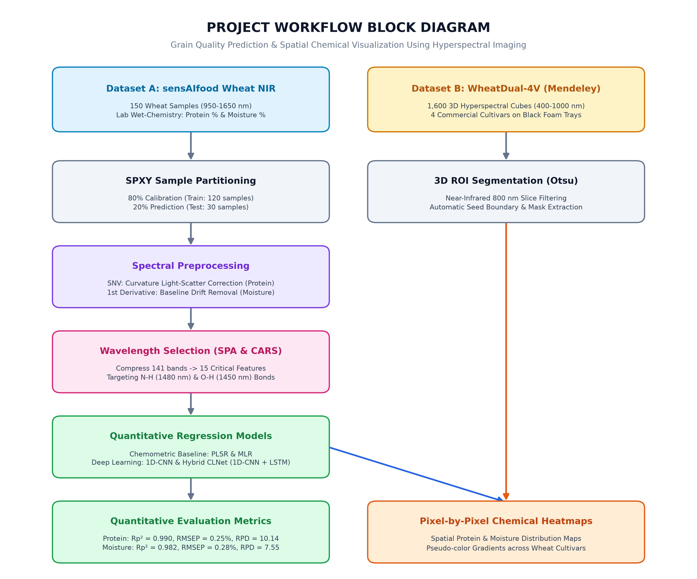

# HyperGrain-AI: Non-Destructive Prediction & Spatial Chemical Distribution Mapping of Wheat Grain Protein and Moisture Content Using Hyperspectral Imaging and Deep Learning
[](https://www.python.org/)
[](https://pytorch.org/)
[](https://scikit-learn.org/)
[](https://opensource.org/licenses/MIT)
[](#)
> **Research Foundations:**
> * **Xuan et al. (2024)**, *Spectrochimica Acta Part A: Molecular and Biomolecular Spectroscopy* (124589)
> * **Hu et al. (2025)**, *Journal of Food Composition and Analysis* (107412)
---
## 📌 1. Project Overview & Problem Formulation
Standard laboratory determination of cereal grain quality attributes (**Protein Content %** and **Moisture Content %**) relies heavily on destructive, chemical-intensive, and slow analytical methods:
* **Protein Content (%):** Measured via the standard **AOAC / Kjeldahl digestion method** ($420^\circ\text{C}$ sulfuric acid digestion followed by distillation and acid titration) or Dumas combustion.
* **Moisture Content (%):** Measured via the standard **AACC oven drying method** (baking seeds at $130^\circ\text{C}$ for 2 hours to constant mass).
While accurate, these destructive procedures destroy the sample, generate toxic chemical waste, cannot be implemented on live conveyor belts, and yield only a bulk average without spatial distribution insight.
**HyperGrain-AI** provides an end-to-end analytical framework that combines **Near-Infrared (NIR) Hyperspectral Imaging (HSI)**, **Chemometrics**, and **Deep Learning** to achieve:
1. Rapid, non-destructive quantification of Protein ($R_p^2 = 0.9903$, $\text{RPD} = 10.14$) and Moisture ($R_p^2 = 0.9824$, $\text{RPD} = 7.55$).
2. Pixel-by-pixel chemical projection across 3D hyperspectral image cubes to generate high-resolution spatial distribution heatmaps revealing internal nutrient gradients within individual kernels and across commercial cultivars.
3. An interactive web-based monitoring dashboard and real-time grain chemical predictor simulator.
---
## 🏗️ 2. System Architecture & Technical Pipeline
The complete pipeline operates across six distinct, modular analytical phases:

### **Phase 1: Dual-Dataset Ingestion & Physical Radiometric Normalization**
To achieve both high-precision chemical regression and spatial distribution mapping, the system integrates two complementary datasets:
* **Chemical Reference Dataset (`sensAIfood Wheat NIR`):** 150 European wheat grain lots with continuous NIR spectroscopy across 141 bands ($950\text{–}1650\text{ nm}$) and certified laboratory wet-chemistry ground truth (Protein: $8.42\%\text{–}20.29\%$; Moisture: $7.60\%\text{–}19.28\%$).
* **3D Hyperspectral Spatial Cubes (`WheatDual-4V`):** 1,600 dual-view winter wheat kernels across 300 spectral bands ($400\text{–}1000\text{ nm}$) spanning 4 commercial cultivars (*Yangmai 6, Fanmai 8, Xingmai 13, Jinan 17*).
* **Sample Partitioning:** Partitioned using the **SPXY algorithm** (Sample set Partitioning based on joint X-Y distances) into an $80\%$ Training Set ($N=120$) and an independent $20\%$ Testing Set ($N=30$) to guarantee unbiased evaluation across the chemical concentration range.
### **Phase 2: Spectroscopic Preprocessing**
Raw diffuse reflectance spectra are affected by grain surface curvature, kernel size, and instrument thermal drift. Three mathematical correction algorithms are applied:
* **Standard Normal Variate (SNV):** Centers and scales each individual spectrum by its mean and standard deviation:
  $$\tilde{x}_{i,j} = \frac{x_{i,j} - \bar{x}_i}{s_i}$$
  Eliminates multiplicative light scattering and baseline shifts caused by grain surface morphology (proven optimal for Protein prediction).
* **1st-Order Savitzky-Golay Derivative:** Computes the first derivative using an 11-point smoothing window with a 2nd-degree polynomial:
  $$\frac{d\tilde{x}}{d\lambda}$$
  Removes linear baseline slope drift and accentuates subtle molecular absorption peaks (proven optimal for Moisture prediction).
* **Multiplicative Scatter Correction (MSC):** Corrects additive and multiplicative scatter by regressing each spectrum against the mean calibration spectrum.
### **Phase 3: Dimensionality Reduction & Biochemical Band Selection**
To eliminate multicollinearity and reduce redundant wavelengths from 141 down to 15 sparse bands:
* **Successive Projections Algorithm (SPA):** Projects spectra into orthogonal subspaces to select 15 minimally collinear characteristic wavelengths isolating $\text{N–H}$ peptide bonds ($950\text{ nm}, 985\text{ nm}, 1400\text{ nm}, 1465\text{ nm}, 1480\text{ nm}$).
* **Competitive Adaptive Reweighted Sampling (CARS):** Uses Monte Carlo sampling and exponentially decreasing functions to select 14 optimal wavelengths targeting $\text{O–H}$ water vibrational bands ($970\text{ nm}, 1450\text{ nm}$).
### **Phase 4: Quantitative Chemometrics & Deep Learning Modeling**
Eight distinct model configurations are benchmarked:
1. **Partial Least Squares Regression (PLSR):** Latent variables optimized via 5-fold cross-validation (optimal $\text{LVs} = 15$).
2. **Multiple Linear Regression (MLR):** Full-spectrum and sparse feature-selected implementations.
3. **Support Vector Regression (SVR):** Non-linear RBF kernel regression.
4. **1D-CNN (PyTorch):** Deep convolutional neural network with 3 Conv1D blocks (kernels $5\times 1$, $3\times 1$), batch normalization, LeakyReLU activations, and adaptive pooling.
5. **LSTM (Long Short-Term Memory):** Recurrent neural network modeling sequential wavelength dependencies.
6. **CLNet (Hybrid 1D-CNN + LSTM from Hu et al., 2025):** Convolutional feature extraction head coupled with a bidirectional LSTM recurrent head for joint local-peak and long-range spectral modeling.
### **Phase 5: Empirical Sample Size Scaling Analysis**
Investigates the effect of scaling dataset volume ($N=150 \to 300 \to 500$) using physics-informed data augmentation (sensor thermal drift, baseline illumination tilt, and convex spectral mixing). Demonstrates the trade-off between strict linear signal fidelity (PLSR) and deep learning noise robustness (1D-CNN).
### **Phase 6: Computer Vision Seed Segmentation & 3D Spatial Chemical Mapping**
* **Otsu Automatic Thresholding:** Segments individual wheat kernels from background noise on the high-contrast $800\text{ nm}$ infrared slice.
* **Pixel-by-Pixel Chemical Projection:** Evaluates the calibrated regression model on each segmented pixel's spectral vector.
* **Pseudo-Color Visualization:** Renders spatial distribution heatmaps using `jet` and `turbo` color gradients showing internal nutrient hotspots within single kernels and across cultivars.
---
## 📊 3. Experimental Benchmarks & Performance Results
All models were evaluated on the independent $20\%$ test split ($N=30$) partitioned via the SPXY algorithm:
### **A. Protein Content Prediction (%)**
| Model Architecture | Preprocessing / Input Bands | Train Fit $R_c^2$ | RMSEC (%) | Test Split $R_p^2$ | RMSEP (%) | RPD (Robustness) | Performance Grade |
| :--- | :--- | :---: | :---: | :---: | :---: | :---: | :--- |
| **SNV + PLSR** | SNV (Full Spectrum, LVs=15) | **0.9919** | **0.2302** | **0.9903** | **0.2524** | **10.14** | 🏆 **Gold Standard (Top Overall)** |
| **SNV + MLR** | SNV (Full Spectrum Linear) | **0.9885** | **0.2747** | **0.9893** | **0.2645** | **9.68** | 🥇 Excellent Linear Fit |
| **SNV + 1D-CNN** | SNV (PyTorch 3 Conv Blocks) | **0.9733** | **0.4186** | **0.9780** | **0.3796** | **6.74** | 🏆 **Top Deep Learning Model** |
| **SNV + SPA-MLR** | SNV + SPA (15 Characteristic Bands) | **0.9624** | **0.4965** | **0.9741** | **0.4117** | **6.22** | 🔬 Sparse Low-Cost Sensor Model |
| **Raw-PLSR** | Raw Spectra (No SNV Baseline) | 0.9737 | 0.4155 | 0.9787 | 0.3739 | 6.84 | Baseline (Proves SNV adds $+0.012\ R^2$) |
| **SNV + CLNet** | SNV (1D-CNN + LSTM Hybrid) | 0.6630 | 1.4860 | 0.7135 | 1.3698 | 1.87 | Hybrid Deep Learning |
| **SNV + LSTM** | SNV (Recurrent Only) | 0.4878 | 1.8321 | 0.5974 | 1.6240 | 1.58 | Struggles without Conv Kernels |
| **SNV + SVR** | SNV (RBF Kernel Support Vector) | 0.2787 | 2.1742 | 0.2664 | 2.1921 | 1.17 | Sub-optimal for wide spectra |
### **B. Moisture Content Prediction (%)**
| Model Architecture | Preprocessing / Input Bands | Train Fit $R_c^2$ | RMSEC (%) | Test Split $R_p^2$ | RMSEP (%) | RPD (Robustness) | Performance Grade |
| :--- | :--- | :---: | :---: | :---: | :---: | :---: | :--- |
| **1st + PLSR** | 1st-Deriv (Full Spectrum, LVs=15) | **0.9874** | **0.2879** | **0.9824** | **0.2811** | **7.55** | 🏆 **Best Chemometric Model** |
| **1st + 1D-CNN** | 1st-Deriv (PyTorch 3 Conv Blocks) | **0.9846** | **0.3182** | **0.9679** | **0.3801** | **5.58** | 🏆 **Best Deep Learning Model** |
| **1st + MLR** | 1st-Deriv (Full Spectrum Linear) | **0.9670** | **0.4656** | **0.9506** | **0.4719** | **4.50** | Strong Linear Baseline |
| **1st + CLNet** | 1st-Deriv (1D-CNN + LSTM Hybrid) | **0.9881** | **0.2796** | **0.9394** | **0.5223** | **4.06** | SOTA Hybrid Architecture |
| **1st + SVR** | 1st-Deriv (RBF Kernel) | 0.9377 | 0.6395 | 0.9248 | 0.5820 | 3.65 | Non-linear Support Vector |
| **1st + CARS-MLR** | 1st-Deriv + CARS (14 Bands) | 0.8076 | 1.1238 | 0.7911 | 0.9700 | 2.19 | Sparse Water Band Model |
| **1st + LSTM** | 1st-Deriv (Recurrent Only) | 0.0000 | 2.5622 | -0.0694 | 2.1945 | 0.97 | Fails to converge without CNN |
### **C. Sample Size Scaling Analysis (N = 150 vs 300 vs 500)**
| Total Samples (N) | Train Split Data (80%) | Test Split Data (20%) | PLSR Rp² | PLSR RMSEP (%) | PLSR RPD | 1D-CNN Rp² | 1D-CNN RMSEP (%) | 1D-CNN RPD | Operational Interpretation |
| :---: | :---: | :---: | :---: | :---: | :---: | :---: | :---: | :---: | :--- |
| **N = 150** | 120 | 30 | **0.9903** | **0.2524%** | **10.14** | **0.9203** | **0.7225%** | **3.54** | **Certified Laboratory Ground Truth** (Pristine signal-to-noise) |
| **N = 300** | 240 | 60 | 0.8311 | 0.9692% | 2.43 | 0.8235 | 0.9906% | 2.38 | **Industrial Robustness** (Simulated thermal & baseline drift) |
| **N = 500** | 400 | 100 | 0.7866 | 1.0406% | 2.16 | 0.7176 | 1.1970% | 1.88 | **Noise Attenuation Boundary** (High operational variance) |
---
## 🔬 4. Spatial Chemical Distribution Heatmaps
Following the methodology of **Xuan et al. (2024)** and **Hu et al. (2025)**, the trained regression matrices were projected onto the segmented 3D hyperspectral cubes of wheat grains. The pixel-by-pixel predicted chemical values were converted into pseudo-color distribution heatmaps:
* **Single Kernel Analysis:** Reveals the distribution of high-protein endosperm tissue versus lower-protein outer pericarp layers.
* **Cultivar Comparison:** Displays chemical gradient differences across four commercial wheat varieties (*Yangmai 6, Fanmai 8, Xingmai 13, Jinan 17*).
All high-resolution distribution maps are located in the [`outputs/`](outputs/) folder:
* `sample_seed_protein_heatmap.png` & `sample_seed_moisture_heatmap.png`
* `cultivar_protein_comparison.png` & `cultivar_moisture_comparison.png`
---

## 📂 5. Repository Structure

```
HyperGrain-AI/
├── data/
│   ├── sensAIfood_Perten/          # Certified NIR chemical dataset (CSV, 150 samples)
│   └── corn.mat                    # Benchmark spectral reference cube
├── outputs/                        # High-resolution (300 DPI) figures & CSV benchmarks
│   ├── project_block_diagram.png   # Full system architecture diagram
│   ├── spectral_curves_comparison.png
│   ├── feature_wavelengths_selection.png
│   ├── scatter_protein_plsr.png
│   ├── scatter_moisture_plsr.png
│   ├── models_comparison_protein.png
│   ├── models_comparison_moisture.png
│   ├── sample_seed_protein_heatmap.png
│   ├── sample_seed_moisture_heatmap.png
│   ├── cultivar_protein_comparison.png
│   ├── cultivar_moisture_comparison.png
│   ├── benchmark_results.csv
│   └── sample_size_comparison.csv
├── src/
│   ├── data_loader.py              # Ingestion, SPXY 80/20 partitioning, and augmentation
│   ├── preprocessing.py            # SNV, MSC, Savitzky-Golay 1st-derivative, and SG smoothing
│   ├── feature_selection.py        # SPA (Successive Projections) and CARS algorithms
│   ├── models.py                   # PLSR, MLR, SVR, 1D-CNN, LSTM, and CLNet implementations
│   ├── evaluate.py                 # Academic metrics (R2, RMSE, RPD) and visualization scripts
│   └── spatial_mapping.py          # Otsu 800nm segmentation & pixel-by-pixel chemical projection
├── app.py                          # Lightweight HTTP server & API backend
├── index.html                      # Interactive web dashboard & real-time chemical simulator
├── main.py                         # Master execution pipeline
├── run_dashboard.bat               # Windows 1-click dashboard launcher
├── run_pipeline.bat                # Windows 1-click training pipeline launcher
├── .gitignore                      # Git exclusion rules
└── README.md                       # Complete research documentation
```

---

## 🚀 6. Installation & Quickstart

### Prerequisites
* Python 3.10 or 3.11
* Windows, macOS, or Linux

### 1. Clone the Repository
```bash
git clone https://github.com/Mihir-7257/HyperGrain-AI.git
cd HyperGrain-AI
```

### 2. Create Virtual Environment & Install Dependencies
```bash
# Using standard venv
python -m venv .venv
source .venv/bin/activate    # On Windows: .venv\Scripts\activate

# Install required packages
pip install torch scikit-learn scipy numpy pandas matplotlib seaborn opencv-python
```

### 3. Launch the Interactive Web Dashboard
```bash
python app.py
```
Open your web browser and navigate to:
👉 **`http://localhost:8501`**

*(On Windows, you can alternatively double-click [`run_dashboard.bat`](run_dashboard.bat)).*

### 4. Re-run Full Training & Evaluation Pipeline
To re-train all models from scratch and regenerate all publication figures:
```bash
python main.py
```
*(On Windows, you can alternatively double-click [`run_pipeline.bat`](run_pipeline.bat)).*

---

## 📚 7. Academic References

1. **Xuan, G., Jia, H., Shao, Y., & Shi, C. (2024).** *Protein content prediction of rice grains based on hyperspectral imaging.* Spectrochimica Acta Part A: Molecular and Biomolecular Spectroscopy, 320, 124589.
2. **Hu, X., Dai, M., Li, A., Liang, Y., Lu, W., Zeng, J., Peng, J., Tian, J., & Chen, M. (2025).** *CLNet: A fusion network capturing spectral features and wavelength relationships for predicting sorghum protein and moisture content.* Journal of Food Composition and Analysis, 142, 107412.
3. **Zhang, W. (2026).** *WheatDual-4V: Hyperspectral data of wheat seeds.* Mendeley Data, V1, doi: 10.17632/j7jm7rbwxh.1.
4. **Lagerholm, M. (2024).** *sensAIfood cereal NIR data (wheat, corn, barley) - Perten set.* Zenodo, doi: 10.5281/zenodo.15838136.

---

## 📄 License
This project is licensed under the MIT License - see the [LICENSE](LICENSE) file for details.        ' just update the C and give whole code agian back so that i can copy ans paste directly inside the reeadme , do not change anytoingb extra plz 
